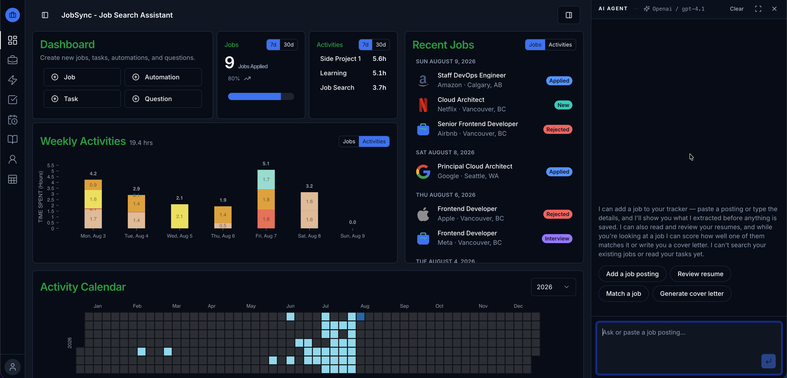
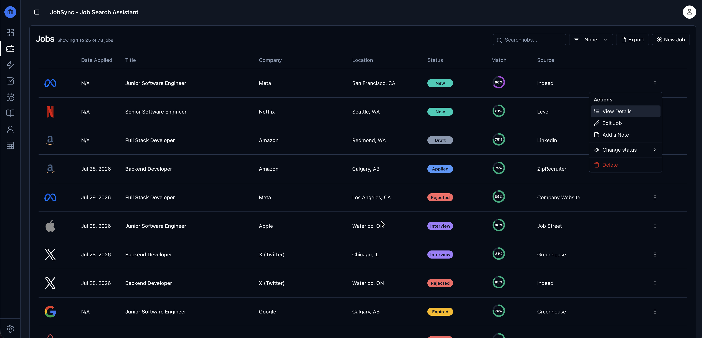

# JobSync

**A self-hosted job search assistant: track applications, manage resumes, and let an AI assistant review, match and prepare — with your data staying on your own machine.**

[](./LICENSE)




## About this project

This is a personal hobby project and a **fork of [Gsync/jobsync](https://github.com/Gsync/jobsync)** (MIT licensed). The application foundation — job tracker, dashboard, resume management, tasks and activities, the AI chat assistant and the MCP server — comes from the original project. I use this fork to learn, to experiment, and to build the features I wanted for my own job search. See [What this fork adds](#what-this-fork-adds) for exactly what is mine.

It is a hobby project: use it, read it, learn from it — but expect rough edges, and no support guarantees.

**Built with AI assistance.** This fork was developed with AI coding assistants, mainly [Claude Code](https://claude.com/claude-code), which is why many commits carry a `Co-Authored-By: Claude` trailer. The code is covered by an automated test suite (see [Local development](#local-development)).

## Features

- **Application tracker** — companies, titles, dates, status, notes, and a match score per job.
- **Dashboard** — applications, activity hours and an activity calendar at a glance.
- **Resume management** — multiple resumes, PDF export (Simple or Professional layout), import from PDF or Word (.docx) with section-by-section review.
- **Tasks & activities** — plan work and track time, including breaks.
- **Automated job discovery** — scheduled automations pull new postings, match them against your resume with AI, and surface the best fits for review (see [Job sources](#job-sources)).
- **AI assistant** — a chat panel docked beside the current page. It can review a resume, score a resume against the job you are viewing, write a cover letter, prepare you for an interview, and add a job from a pasted posting. It asks for confirmation before it saves anything.
- **MCP server** — AI agents such as Claude Desktop can add jobs and interview questions to JobSync from chat, with your approval (see [MCP server](#mcp-server)).
- **Local or cloud AI** — run models locally with Ollama, or use OpenAI, DeepSeek, Google Gemini or OpenRouter.
- **Backup & restore** — export your data and restore it with a guarded import (Settings > Data).



## What this fork adds

On top of upstream, this fork adds:

- **Prompt Library** — edit or extend the instructions JobSync sends to the AI model, per account (Settings > Prompt Library).
- **Interview preparation** — for a job, generates likely interview questions and researches the company and its interview process. Available on the job page and through the AI assistant. A [Tavily](https://tavily.com) key is optional and enables web research.
- **Email-alert job source** — connect one IMAP mailbox and let automations read job-alert emails. The mailbox password is encrypted at rest.
- **Bundesagentur für Arbeit** as a job source for automations (German job market).
- **Job PDF import** — prefill the Add Job form from a PDF of a posting.
- **Run now** for automations, to trigger a run without waiting for the schedule.
- **More robust AI output** — recovers structured output from models that wrap their JSON in a code fence.
- Docker and build fixes (self-hosted font instead of a Google Fonts fetch at build time, lockfile fixes), and safer secret handling (see [Security notes](#security-notes)).

## Quick start (Docker)

Requires [Docker](https://www.docker.com) with Compose.

```sh
git clone https://github.com/mischelboss/jobsync.git
cd jobsync
docker compose up
```

The first start builds the image, which can take a few minutes. Then open <http://localhost:3737> and create your account. No configuration is required: secrets are generated on first start (see [Security notes](#security-notes)).

AI providers are configured in the app after you sign in: **Settings > AI Provider** to pick a provider and model, **Settings > API Keys** for the keys.

Your data (SQLite database, uploaded resumes, generated secrets) lives in `./jobsyncdb/data`. Back that folder up.

### Configuration (optional)

Set these in a `.env` file next to `docker-compose.yml` (start from [`.env.example`](./.env.example)) or in your shell.

| Variable | Description |
|---|---|
| `TZ` | Your timezone, e.g. `Europe/Berlin`. **Set this on remote servers**, otherwise activity times can shift. |
| `NEXTAUTH_URL` | The URL you open the app at. Change it from `localhost` if you run it on a homelab server or behind a proxy. |
| `AUTH_SECRET` | Signs sessions. Generated automatically if not set. |
| `ENCRYPTION_KEY` | Encrypts stored API keys and the IMAP password. Generated automatically if not set. Must stay stable. |
| `OLLAMA_BASE_URL` | Where Ollama runs. Defaults to the Docker host (`http://host.docker.internal:11434`). |
| `MCP_ENABLED` | Enables the MCP server. On by default in the Docker setup. |
| `*_API_KEY` | Optional fallback keys for the AI providers. Keys saved in the app take precedence. |

### Updating

From the project directory:

```sh
./deploy.sh          # macOS / Linux / WSL
.\deploy.ps1         # Windows PowerShell
```

The script pulls the latest changes from this repository, rebuilds the image and restarts the container. Without the script: `git pull && docker compose up -d --build`.

## Local development

Requires Node.js 20 and npm.

```sh
npm install
cp .env.example .env     # then uncomment and set AUTH_SECRET and ENCRYPTION_KEY (openssl rand -base64 32)
npx prisma migrate dev
npm run dev              # http://localhost:3737
```

| Command | What it does |
|---|---|
| `npm test` | Unit and component tests (Vitest) |
| `npm run lint` | ESLint |
| `npm run test:e2e` | End-to-end tests (Playwright; starts the dev server itself) |
| `npm run eval:all` | Prompt regression tests against real models — see [`evals/`](./evals/README.md). Needs provider API keys or a local Ollama. |

**Stack:** Next.js 15 (App Router, server actions), React 19, TypeScript, Prisma with SQLite, Auth.js, Tailwind CSS 4 with shadcn/ui, the Vercel AI SDK, Vitest, Playwright and promptfoo.

## AI providers

Pick the provider and model under **Settings > AI Provider**. Ollama is the default.

The selected model must support **structured output** and **tool calling** — the AI assistant works by calling tools, so a model without tool support replies with text instead of doing anything. The assistant has been tested end to end with `qwen3.5:9b` on Ollama (fully local), `deepseek-v4-flash` and OpenAI `gpt-4.1`; other tool-calling models should work too.

| Provider | Key |
|---|---|
| **Ollama** (local) | None. Install [Ollama](https://ollama.com); available models are listed automatically. Raising its context length from 4k to 16k helps automated job matching with long resumes and postings. |
| **OpenAI** | [platform.openai.com/api-keys](https://platform.openai.com/api-keys) |
| **DeepSeek** | [platform.deepseek.com/api_keys](https://platform.deepseek.com/api_keys) |
| **Google Gemini** | [aistudio.google.com/apikey](https://aistudio.google.com/apikey) |
| **OpenRouter** | [openrouter.ai/keys](https://openrouter.ai/keys) |

Enter keys under **Settings > API Keys**. If you run JobSync on a homelab server and Ollama on another machine, expose Ollama on your network and point the Ollama base URL there.

## Job sources

Automations (in the sidebar) search on a schedule and AI-match each posting against your resume. Discovered jobs wait for your review: accept them into your tracker or dismiss them.

- **Greenhouse** and **Lever** — track specific companies by name (from a built-in directory) or by pasting a board URL. A fast local relevance score ranks every posting first; the AI match runs only on the top candidates to keep costs bounded. No API key required.
- **Bundesagentur für Arbeit** — the German federal job board. No API key required.
- **Email alerts** — read job-alert emails from an IMAP mailbox you connect under **Settings > Email Mailbox**. For Gmail or Outlook with 2FA, use an app password.

## MCP server

JobSync exposes an [MCP](https://modelcontextprotocol.io) server so AI agents (Claude Desktop and others) can add jobs and Question Bank entries directly, with your approval. Example prompts:

- *"Add this job to JobSync: Senior Backend Engineer at Acme Corp, hybrid, … (paste the posting)"*
- *"I was just asked 'How would you design a rate limiter?' in an interview — add it to my Question Bank with my answer: …"*

The agent resolves or creates company, title, location and tags by name and reports what it matched versus created. If you have set a default resume, it also scores the fit and saves the match to the job.

**1. Generate a token.** In JobSync, open **Settings > MCP Access**, click **Generate**, name it (e.g. "Claude Desktop") and choose an expiry. Copy the token — it is shown only once.

**2. Add it to your MCP client.**

<details>
<summary><strong>Claude Desktop</strong></summary>

Claude Desktop only supports local (stdio) servers directly, so `mcp-remote` bridges to JobSync. Open **Settings > Developer > Edit Config** and add:

```json
{
  "mcpServers": {
    "jobsync": {
      "command": "npx",
      "args": [
        "mcp-remote",
        "http://<your-jobsync-url>/api/mcp",
        "--header",
        "Authorization: Bearer <your-token>"
      ]
    }
  }
}
```

Then fully restart Claude Desktop (quit, not just close the window).

</details>

<details>
<summary><strong>Other clients</strong></summary>

Clients that support `streamable-http` natively can connect directly:

```json
{
  "mcpServers": {
    "jobsync": {
      "type": "streamable-http",
      "url": "http://<your-jobsync-url>/api/mcp",
      "headers": { "Authorization": "Bearer <your-token>" }
    }
  }
}
```

</details>

> **Plain-HTTP LAN address?** If your JobSync URL is `http://` and not `localhost` or HTTPS, add `--allow-http` to the `mcp-remote` args — it refuses non-HTTPS URLs by default.

## Security notes

JobSync is built for **self-hosting on a trusted network**. It is a hobby project that has not had a professional security audit.

- **No built-in HTTPS.** If you expose it beyond your own network, put it behind a reverse proxy with TLS, and set `NEXTAUTH_URL` accordingly.
- **Secrets are generated, not shipped.** If you do not set `AUTH_SECRET` and `ENCRYPTION_KEY`, the Docker entrypoint creates random ones on first start and stores them in the data volume (`./jobsyncdb/data`, mode 600). They sit next to the database, so for stronger separation provide `ENCRYPTION_KEY` through your environment instead.
- **Stored credentials are encrypted at rest** (AES-256-GCM): provider API keys and the IMAP password. **Back up your `ENCRYPTION_KEY`** — without it they cannot be recovered and you would have to enter them again.
- **MCP tokens** are stored hashed, expire, and can be revoked in Settings.
- **Pasted job postings are treated as untrusted text.** The AI assistant is deliberately narrow in what it can see and do, and instructions hidden in a posting cannot make it act on your data. The eval suite includes prompt-injection test cases for this.
- **If you ran an earlier revision of this fork** without setting `ENCRYPTION_KEY`, it used a fixed placeholder key. After updating, a new random key is generated and you need to re-enter your API keys and IMAP password in Settings. Sessions are also reset once.

To report a security problem, please do not open a public issue. Use the **Security** tab of this repository > **Report a vulnerability** instead.

## Contributing

Pull requests are welcome — see [CONTRIBUTING.md](./CONTRIBUTING.md). Issues are turned off on this repository, so a pull request (even a small one) is the way to suggest a fix or an improvement. This project follows a [Code of Conduct](./CODE_OF_CONDUCT.md).

If a problem is in code that comes from the original project, report it [upstream](https://github.com/Gsync/jobsync/issues).

## License and credits

Released under the [MIT License](./LICENSE). The original work is © gsync; changes in this fork are © mischelboss. Thanks to the author of the [original JobSync](https://github.com/Gsync/jobsync) for the foundation, and to the projects it builds on:

[React](https://github.com/facebook/react) · [Next.js](https://github.com/vercel/next.js) · [shadcn/ui](https://github.com/shadcn-ui/ui) · [Prisma](https://github.com/prisma/prisma) · [Tailwind CSS](https://github.com/tailwindlabs/tailwindcss) · [Tiptap](https://github.com/ueberdosis/tiptap) · [Nivo](https://github.com/plouc/nivo) · [SQLite](https://www.sqlite.org) · [Vercel AI SDK](https://github.com/vercel/ai) · [Ollama](https://github.com/ollama/ollama)
